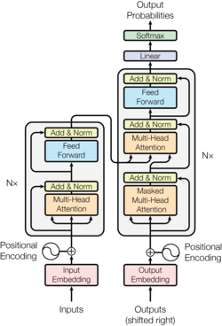

# Build and Train a Modern LLM (GPT-2) from Scratch

## Table of Contents

- [1. Introduction](#1-introduction)
- [2. Data Preparation](#2-data-preparation)
  - [2.1 Data Preprocessing](#data-preprocessing)
  - [2.2 Downloading Datasets from Hugging Face](#downloading-datasets-from-hugging-face)
- [3. Coding the LLM Architecture](#coding-the-llm-architecture)
  - [3.1 Masked Multi-Head Attention](#masked-multi-head-attention)
  - [3.2 Layer Normalization](#layer-normalization)
  - [3.3 Transformer Block](#transformer-block)
  - [3.4 Feed-Forward Network](#feed-forward-network)
  - [3.5 Linear Output Layer](#linear-output-layer)
  - [3.6 Residual Connections](#residual-connections)
  - [3.7 Token Embeddings](#token-embeddings)
  - [3.8 Positional Embeddings](#positional-embeddings)
  - [3.9 Dropout](#dropout)
  - [3.10 Assembling the LLM](#assembling-the-llm)
- [4. Pretraining](#pretraining)
  - [4.1 Data Tokenization](#data-tokenization)
  - [4.2 Data Sampling](#data-sampling)
  - [4.3 Dataset](#dataset)
  - [4.4 DataLoader](#dataloader)
  - [4.5 Data Partitioning](#data-partitioning)
  - [4.6 Hyperparameters and Training](#hyperparameters-and-training)
- [5. Post-Training and Fine-Tuning](#post-training-and-fine-tuning)
  - [5.1 Data Tokenization](#data-tokenization-1)
  - [5.2 Choosing a Prompt Style](#choosing-a-prompt-style)
  - [5.3 Implementing a Prompt Formatting Function](#implementing-a-prompt-formatting-function)
  - [5.4 Data Sampling for Post-Training](#data-sampling-for-post-training)
    - [Creating the Dataset](#creating-the-dataset)
    - [Creating the DataLoader](#creating-the-dataloader)
    - [Creating a Custom Collate Function](#creating-a-custom-collate-function)
    - [Creating a DataLoader with the Custom Collate Function](#creating-a-dataloader-with-the-custom-collate-function)
  - [5.5 Data Partitioning](#data-partitioning-1)
  - [5.6 Hyperparameter Configuration and Training](#hyperparameter-configuration-and-training)


# 1. Introduction

The four most important ingredients for modern LLMs are **data, compute, power, and Transformer architecture.**

### 1.1 Data

Data consists of text, code, images, or audio that an LLM uses to learn patterns and relationships. It provides the examples that a language model learns from to understand how language works.

### 1.2 Compute

Compute refers to the raw computational power used to train an LLM. It represents the number of calculations the hardware must perform while the model learns.

Compute is provided by GPUs (such as NVIDIA H100 or A100), TPUs (Google's custom-designed chips), and clusters, which are collections of GPUs and TPUs working together.

Compute is measured in FLOPs (Floating-Point Operations), which represent the number of floating-point calculations performed, or GPU-hours, which measure how many GPUs run and for how long.

### 1.3 Power

Power refers to the electricity required to run and cool the computing hardware used to train and run an LLM.

For instance, a modern GPU like the NVIDIA H100 can draw up to 700 watts. Watts measure the amount of electrical power consumed at any given moment.

### 1.4 Transformer Architecture

The Transformer architecture, introduced in Google's 2017 research paper titled *"Attention Is All You Need,"* made modern LLMs possible.

It addressed two major bottlenecks that limited earlier language models: slow sequential processing and difficulty retaining information from long sequences of text.


# STAGE I

# 2. Data Preparation

Data is the experience, culture, language, and knowledge base of modern LLMs (Large Language Models).

The first step in preparing a dataset for LLM training is to collect data from various sources, including domain-specific sources. These sources can come in different formats, such as web pages, S3 storage, SQL databases, PDF documents, domain-specific documents, curated instruction-answer pairs, and human-generated conversations.

### Notable Sources for Dataset Preparation

1. **WebText2:** Web-crawled data.
2. **Common Crawl:** A large collection of web-crawled data that can be filtered for quality.
3. **Books1:** An internet-based book corpus.
4. **Books2:** An internet-based book corpus.
5. **Wikipedia:** An internet-based collection of encyclopedic text.
6. **arXiv:** A collection of academic research papers.
7. **TinyStories:** This dataset was introduced in the research paper *"TinyStories: How Small Can Language Models Be and Still Speak Coherent English?"*
8. **FineWeb-Edu:** Web text filtered using an educational-quality classifier.
9. **Dolly 5k:** A relatively small dataset of instruction-answer pairs used to teach models how to answer questions, summarize text, and follow instructions.
10. **OpenAssistant (OASST1):** A dataset of human-generated conversations and assistant responses, including multilingual examples.
11. **Stanford Alpaca:** A collection of instruction-response pairs used for supervised fine-tuning.

Training an LLM from scratch using a large dataset is very expensive. For instance, the estimated pretraining cost of GPT-3 was approximately $4.6 million in cloud computing alone.

Due to cost limitations and to keep things simple, we will train our LLM using a carefully selected, relatively small dataset that we can comfortably work with on free Google Colab or consumer devices such as laptops.

For this purpose, we will use **TinyStories** as our pretraining dataset. It was introduced in the research paper *"TinyStories: How Small Can Language Models Be and Still Speak Coherent English?"* It consists of short, simple stories.

For post-training and fine-tuning, we will use the **Stanford Alpaca** dataset.

An alternative to TinyStories for pretraining is **FineWeb-Edu**. It is a web-text dataset filtered using an educational-quality classifier. Models trained on this dataset have outperformed models trained on much larger, unfiltered corpora in certain reasoning and knowledge benchmarks.

However, training a model on this dataset is more expensive because it requires more computational resources, storage, and power.

Therefore, we will stick with TinyStories, as we assume that anyone following this tutorial is doing so primarily for educational purposes and experimentation.

## Data Preprocessing

Data preprocessing involves cleaning and preparing raw text before the model ever sees it. Raw data from the internet is often messy, and preprocessing transforms it into a format that a model can learn from efficiently.

The steps involved in data preprocessing are:

1. **Collection and Extraction:** Extract text from raw sources such as web pages (stripping unwanted elements like HTML tags, menus, advertisements, and scripts), PDFs, and code repositories while keeping only the relevant content.

2. **Language Filtering:** Keep the languages you want and discard the rest using a language detection tool.

3. **Quality Filtering:** Remove low-quality text, such as spam, gibberish, boilerplate text, pages containing mostly lists of links, and text with unusual punctuation patterns.

4. **Deduplication:** Remove exact and near-duplicate documents.

5. **Safety and Privacy Cleaning:** Remove or mask personal information and filter out toxic or harmful content.

6. **Decontamination:** Remove text that overlaps with benchmark test sets to ensure that evaluation scores are not inflated because the model has already seen the answers.

## Downloading Datasets from Hugging Face

Hugging Face is an open platform often described as the "GitHub of machine learning." It hosts datasets that machine learning developers, researchers, and practitioners can download and use.

It provides a platform where pretraining and post-training datasets are shared, allowing machine learning teams to access existing datasets without having to search for and clean raw data from scratch.

For this tutorial, we will download all our datasets from Hugging Face.

To download **TinyStories** from Hugging Face for pretraining, use the following code snippet:

```python
dataset = load_dataset(
    "roneneldan/TinyStories",
    split="train"
)
```

```python
dataset = load_dataset(
    "roneneldan/TinyStories",
    split="validation"
)
```

To download **Stanford Alpaca** from Hugging Face for post-training and fine-tuning, use the following code snippet:
```python
dataset = load_dataset("tatsu-lab/alpaca", split="train")
```


Then, split the dataset into training and validation sets using the following code snippet:

```python
dataset = dataset.train_test_split(
    test_size=0.1,
    seed=42
)

Access the splits
train_dataset = dataset["train"]
val_dataset = dataset["test"]
```


# STAGE II

# CODING THE LLM ARCHITECTURE

An LLM (Large Language Model) is a type of artificial intelligence (AI) model trained on large amounts of data to understand and perform various tasks, such as code generation, natural language generation, computer vision, and speech recognition.

Examples of LLMs include GPT (which powers ChatGPT), Llama, Qwen, and others.

In this tutorial, we will build an LLM based on the GPT architecture. Specifically, we will recreate GPT-2, one of the earlier widely known open-weight language models, by implementing its architecture from scratch.

Modern LLMs experienced a significant leap in capabilities and popularity when researchers at Google published a research paper titled *"Attention Is All You Need."* The paper introduced the Transformer, a neural network architecture built around a mechanism called **Self-Attention**.

The original Transformer architecture, as presented in the paper, is shown below:



*Figure 1: The Transformer architecture (Vaswani et al., 2017).*

The architecture of GPT-2 is shown below:

{}

The GPT-2 architecture consists of several major components:

1. Masked Multi-Head Attention
2. Layer Normalization
3. Transformer Blocks
4. Feed-Forward Network
5. Linear Output Layer
6. Residual Connections (represented by the plus signs)
7. Embedding Layers (Token Embeddings and Positional Embeddings)
8. Dropout

We will implement these components one after another, starting with Masked Multi-Head Attention.

## Masked Multi-Head Attention

Masked Multi-Head Attention is a mechanism that allows a language model to learn relationships between tokens while preventing each token from attending to future tokens.

It is one of the most important components of GPT-style Transformers.

The attention formula is:

\[
Attention(Q,K,V)=Softmax\left(\frac{QK^T}{\sqrt{d_k}}\right)V
\]

Where:
- Q = Query
- K = Key
- V = Value
- \(d_k\) = Dimension of the key vectors.

This formula captures the core operation of the attention mechanism.

Below is the implementation of the masked attention mechanism:

{}

## Layer Normalization

Layer Normalization is a technique used in neural networks, especially in Transformers, to normalize the activations flowing through the network.

It helps stabilize and improve the training process by keeping activation values within a more predictable range. This reduces problems associated with activations becoming excessively large or small.

The implementation of Layer Normalization is shown below:

{}

## Transformer Block

A Transformer is a neural network architecture designed to process sequences of data by learning relationships between their elements using the attention mechanism.

A Transformer block consists of the following key components:

1. Layer Normalization
2. Attention Mechanism
3. Feed-Forward Network
4. Residual Connections

The implementation of the Transformer block is shown below:

{}

## Feed-Forward Network

The Feed-Forward Network is an essential component of a Transformer block.

It further processes each token independently after the attention mechanism has combined information from different tokens.

The implementation of the Feed-Forward Network is shown below:

{}

## Linear Output Layer

The Linear Output Layer converts each token's final hidden representation into a set of scores, also known as logits, corresponding to every token in the vocabulary.

These scores represent how likely each vocabulary token is to be the next token in the sequence.

The implementation of the Linear Output Layer is shown below:

{}

## Residual Connections

Residual connections add the original input to the output of a neural network operation.

They help preserve information as it flows through the network and make it easier to train deeper neural networks by improving gradient flow.

In the GPT-2 architecture, residual connections are represented by plus signs (+).

The formula for a residual connection is:

\[
Y = F(x) + x
\]

## Token Embeddings

How do we convert tokens, represented by integer IDs, into vector representations that a neural network can learn from?

This is the problem that Token Embeddings solve.

Token Embeddings map each token ID to a dense numerical vector that represents it in a continuous vector space.

The implementation of Token Embeddings is shown below:

{}

## Positional Embeddings

Positional Embeddings provide a Transformer with information about the position of each token in a sequence.

Without positional information, the model would have difficulty distinguishing between sequences containing the same tokens arranged in different orders.

The implementation of Positional Embeddings is shown below:

{}

## Dropout

Dropout is a regularization technique used to reduce overfitting.

It helps prevent a model from relying too heavily on particular neurons during training, thereby improving its ability to generalize to unseen data.

The implementation of Dropout is shown below:

{}

## Assembling the LLM

Now that we have implemented and understood the individual components, we can assemble them into a complete GPT-2 architecture.

The implementation of our LLM is shown below:

{}


# STAGE III

# PRETRAINING

Pretraining is the process of teaching a Large Language Model (LLM) the general patterns and structures of language by training it on a large amount of text before teaching it to perform specific tasks.

After pretraining, an LLM learns to predict the next token in a sequence based on the tokens that came before it.

The steps involved in LLM pretraining are:

1. Data Tokenization
2. Data Sampling
3. Data Partitioning
4. Hyperparameter Configuration and Training

## Data Tokenization

Data tokenization is the process of converting raw text into smaller units called tokens, which are then mapped to numerical IDs. This is a necessary processing step before the tokens can be converted into embeddings for an LLM.

There are several open-source tools available for dataset tokenization. Some popular ones include:

1. **Tiktoken:** Developed by OpenAI.
2. **Hugging Face Transformers**
3. **Hugging Face Tokenizers**
4. **SentencePiece**

These tools support token encoding and decoding.

For example:

**Note:** We will use Tiktoken in this tutorial.

{}

```python
ids = tokenizer.encode(text)
text = tokenizer.decode(ids)
```

## Data Sampling

Data sampling is the process of selecting and retrieving portions of your training data to feed into an LLM during training.

Since your dataset might contain billions of tokens, it would be impractical to feed all of them into an LLM at once. Instead, we divide the tokens into smaller portions called batches and feed them to the model during training.

In this tutorial, we will use the **Sliding Window** approach to sample our data.

We will also use a **Dataset** and **DataLoader** to organize and facilitate the data sampling process.

## Dataset

A Dataset is an organized collection of data used to train, validate, or test a machine learning model.

Our custom Dataset class inherits from PyTorch's built-in Dataset class.

The implementation is shown below:

{}

## DataLoader

A DataLoader is a PyTorch utility that efficiently feeds data into a model by grouping samples into batches. It also provides functionality such as shuffling and parallel data loading.

Our DataLoader implementation is shown below:

{}

## Data Partitioning

We partition our dataset into three subsets:

1. **Training Set:** Used to train the model and update its weights.
2. **Validation Set:** Used to evaluate the model during training and monitor its performance on unseen data.
3. **Test Set:** Used to evaluate the model's final performance after training.

The implementation of data partitioning is shown below:

{}

## Hyperparameters and Training

Model hyperparameters are configuration values that an LLM developer sets before or during training to control how the training process is performed.

Examples of important training hyperparameters and configurations include:

1. Learning Rate
2. Number of Epochs
3. Batch Size
4. Weight Decay
5. Warmup Steps
6. Gradient Clipping
7. Optimizer
8. Dropout Rate

The hyperparameter configuration and training implementation are shown below:

{}


# STAGE IV

# POST-TRAINING AND FINE-TUNING

Post-training is the process of improving a pretrained LLM so that it can follow instructions, answer questions helpfully, and perform specific tasks.

Post-training and fine-tuning help a model achieve the following:

- Better instruction following
- Improved conversational abilities
- Task specialization
- Better safety and alignment

The steps involved in post-training are:

1. Data Tokenization
2. Choosing a Prompt Style
3. Implementing a Prompt Formatting Function
4. Data Sampling
5. Data Partitioning
6. Hyperparameter Configuration and Training

## Data Tokenization

This process is the same as in the pretraining stage.

## Choosing a Prompt Style

Prompt style refers to the format or structure used to present training examples to a model.

One example is the **Alpaca Prompt Template**, which we will use in this tutorial.

An example of a formatted data entry for LLM training is shown below:

{}

## Implementing a Prompt Formatting Function

Our prompt formatting function is shown below:

{}

The resulting formatted input is shown below:

{}

## Data Sampling for Post-Training

### Creating the Dataset

Our Dataset implementation is shown below:

{}

### Creating the DataLoader

Our DataLoader implementation requires more than simply using PyTorch's default DataLoader because our training dataset contains samples with sequences of different lengths.

To handle these variable-length sequences, we need a custom **collate function** that prepares and organizes the samples into batches before they are passed to the model.

### Creating a Custom Collate Function

Our custom collate function is shown below:

{}

### Creating a DataLoader with the Custom Collate Function

Our custom DataLoader implementation is shown below:

{}

## Data Partitioning

We partition our dataset into three subsets:

1. **Training Set:** Used to train the model and update its weights.
2. **Validation Set:** Used to evaluate the model during training and monitor its performance.
3. **Test Set:** Used to evaluate the model's final performance after training.

The implementation of data partitioning is shown below:

{}

## Hyperparameter Configuration and Training

Our hyperparameter configuration and training implementation are shown below:

{}


